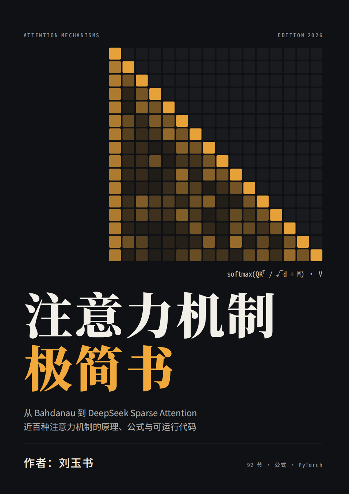

<p align="center">
  
</p>

<h1 align="center">注意力机制极简书</h1>
<p align="center">
  <em>Attention Mechanisms: The Minimalist Guide · 从 Bahdanau 到 DeepSeek Sparse Attention</em>
</p>

<p align="center">
  <a href="#-为什么需要这本书"></a>
  <a href="#-目录"></a>
  <a href="#-特色"></a>
  <a href="#-文件说明"></a>
</p>

---

> **一句话简介**：把过去十年几乎所有的注意力机制，压缩成 92 节、每种配「一句话简介 + 核心公式 + 可运行的 PyTorch 示例」，一页看懂一个思想。

## ✨ 为什么需要这本书

注意力机制是当今大语言模型的心脏，但它的进化速度太快了——从 2015 年的 Bahdanau 注意力，到 2025 年 DeepSeek-V3.2 的可训练稀疏注意力，中间隔着近百个变体，散落在几十篇论文里。想系统搞懂它们？

这本「极简书」的承诺是：**每个机制只占用你 3 分钟**。

- 🎯 **一句话简介**：抓住这个机制到底解决了什么问题；
- 🧮 **核心公式**：看清它改了母公式 `softmax(QKᵀ/√d + M)V` 的哪一部分；
- 🐍 **可运行示例**：每段 PyTorch 代码都基于同一套公共代码，`pip install torch` 后在 CPU 上就能直接跑。

不需要逐篇啃论文，也能建立一张完整的「注意力机制地图」。

## 📊 核心数字

| 指标 | 数值 |
| --- | --- |
| 📖 章节 | 10 章正文 + 附录速查表 |
| 🧩 小节 | **92 节** |
| ⚙️ 覆盖机制 | **近百种** |
| 🐍 可运行示例 | 100+ 段 PyTorch 代码 |
| 📐 核心公式 | 90+ 条 LaTeX 公式 |
| 🗓️ 时间跨度 | 2015 → 2026 年中 |
| 📄 PDF 页数 | 50 页 |

## 🗂️ 目录

| 章节 | 主题 | 代表内容 |
| --- | --- | --- |
| 第 0 章 | 约定与公共代码 | 母公式、记号、`sdpa` 公共函数 |
| 第 1 章 | 基础形式 | Bahdanau、Luong、MHA、掩码 |
| 第 2 章 | KV 共享与压缩 | MQA、GQA、**MLA**、TPA、YOCO |
| 第 3 章 | 稀疏注意力 | Sparse Transformer、SWA、**NSA**、**MoBA**、**DSA** |
| 第 4 章 | 线性与亚二次注意力 | Linear、RetNet、GLA、DeltaNet、Mamba-2、TTT、Titans |
| 第 5 章 | 对注意力本身的改造 | DIFF、Gated Attention、Sigmoid、QK-Norm、MTA |
| 第 6 章 | 位置信息 | Sinusoidal、ALiBi、**RoPE**、YaRN、PaTH |
| 第 7 章 | 记忆、检索与潜变量 | Transformer-XL、Infini-attention、Perceiver、Slot |
| 第 8 章 | 视觉与图结构 | ViT、Swin、Deformable、GAT、MM-DiT |
| 第 9 章 | 系统实现层 | **FlashAttention**、PagedAttention、Ring、FlexAttention、SageAttention |
| 第 10 章 | 混合架构 | Jamba、Qwen3-Next、Kimi Linear 的交错方案 |
| 附录 | 速查表 | 复杂度 / KV 占用 / 代表模型 一页对比 |

## 🎁 特色

- **一根主线贯穿全书**：所有机制都可以看作在改同一个母公式

  $$\mathrm{Attn}(Q,K,V)=\mathrm{softmax}\!\left(\frac{QK^\top}{\sqrt d}+M\right)V$$

  改打分函数、改归一化、改掩码、改 $K/V$ 的来源，还是改底层实现——一目了然。

- **统一视角的对照表**：第 4 章用一张状态更新表，把线性注意力、RetNet、Mamba-2、GLA、DeltaNet、KDA 串成一条「加法 → 衰减 → 门控 → delta 规则 → 测试时学习」的演进线。

- **直击前沿**：覆盖到 2026 年中——NSA（ACL 2025 最佳论文）、Gated Attention（NeurIPS 2025 最佳论文）、DeepSeek Sparse Attention、MoBA、Kimi Delta Attention、Titans 等。

- **代码开箱即用**：所有示例共用同一段公共代码（`torch.manual_seed(0)` 已固定），复制即跑，专注理解原理。

## 🚀 快速开始

```bash
# 1. 安装 PyTorch（CPU 即可）
pip install torch

# 2. 打开本书
#    在线阅读 / 修改：注意力机制极简书.md
#    阅读排版版：注意力机制极简书.pdf
```

以「缩放点积注意力」为例，书中任意代码块都默认已运行过第 0 章的公共代码：

```python
import math, torch, torch.nn as nn, torch.nn.functional as F
torch.manual_seed(0)
B, H, N, d = 2, 4, 16, 32
q, k, v = (torch.randn(B, H, N, d) for _ in range(3))

def sdpa(q, k, v, mask=None):
    s = q @ k.transpose(-2, -1) / math.sqrt(q.size(-1))
    if mask is not None: s = s.masked_fill(~mask, float('-inf'))
    return s.softmax(-1) @ v

out = sdpa(q, k, v)
print(out.shape)   # torch.Size([2, 4, 16, 32])
```

> 示例代码只为说明原理，使用最直白的写法；生产环境请使用各论文官方实现或 `flash-attn`、`fla` 等库。

## 🧭 演进脉络速览

1. **2014–2017** · 从 RNN 上的加性注意力，到 Transformer 的多头缩放点积注意力；
2. **2019–2021** · 二次复杂度成为瓶颈 → 固定稀疏、核化线性、低秩近似；
3. **2022–2023** · FlashAttention 让精确注意力变快，MQA/GQA 解决 KV cache；
4. **2024** · 线性注意力加门控 + 硬件友好的分块算法（GLA、Mamba-2），MLA 压缩 KV；
5. **2025–2026** · 可训练动态稀疏（NSA、MoBA、DSA）、delta 规则类 RNN、输出门控，以及「少量全注意力 + 大量线性层」的混合架构成为前沿主流。

## 📁 文件说明

| 文件 | 说明 |
| --- | --- |
| `注意力机制极简书.md` | 全书 Markdown 源码（可直接编辑、渲染） |
| `注意力机制极简书.pdf` | 排版后的 PDF（50 页，适合阅读与收藏） |
| `pic.png` | 封面图（956 × 1352） |
| `README.md` | 本页 |

## 🙌 致谢

内容整理自各机制的原论文，行文风格致敬「极简」：少即是多。若发现笔误或想补充某个机制，欢迎提 Issue / PR。
